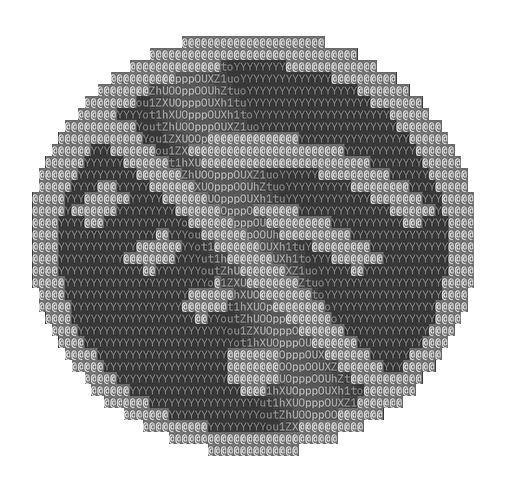

  

<h1 align="center">오프라인코인</h1>

  <strong>틈새시장도 가득찼으니 존재하지 않는 시장을 노리자</strong>

  <a href="README.md">English</a>

오프라인코인은 인터넷이 없어도 돌아가는 암호화폐입니다. 직접 채굴하고, 검증하고, 보냅니다.

## 다운로드

| 내 컴퓨터 | 다운로드 |
|---|---|
| 윈도우 | [윈도우용 OLC Core](https://github.com/needmoretruth/OfflineCoin/releases/latest/download/OLC-Core-windows-x86_64-setup.exe) |
| 애플 칩 맥 | [맥용 OLC Core](https://github.com/needmoretruth/OfflineCoin/releases/latest/download/OLC-Core-macos-apple-silicon.dmg) |
| 인텔 맥 | [인텔 맥용 OLC Core](https://github.com/needmoretruth/OfflineCoin/releases/latest/download/OLC-Core-macos-intel.dmg) |
| 우분투, 데비안, 민트 | [리눅스용 OLC Core](https://github.com/needmoretruth/OfflineCoin/releases/latest/download/OLC-Core-linux-x86_64.deb) |
| 라즈베리파이 | [라즈베리파이용 OLC Core](https://github.com/needmoretruth/OfflineCoin/releases/latest/download/OLC-Core-linux-arm64.deb) |

다른 시스템용 파일은 [릴리스 페이지](https://github.com/needmoretruth/OfflineCoin/releases/latest)에 있습니다.

처음 열 때 컴퓨터가 경고할 수 있습니다.

- **윈도우**에서 「Windows의 PC 보호」가 뜨면 **추가 정보**를 누르고 **실행**을 누르세요.
- **맥**에서 앱을 확인할 수 없다고 나오면 **시스템 설정**, **개인정보 보호 및 보안**으로 가서 **그래도 열기**를 누르세요.

## 시작하기

1. **OLC Core**를 열고 짧은 질문에 답합니다.
2. **채굴 시작**을 누릅니다. 컴퓨터가 코인을 찾기 시작합니다.
3. 블록을 찾으면 홈에 코인이 나타납니다. 홈의 속도 버튼으로 컴퓨터가 얼마나 일할지 정합니다.

코인을 받으려면 **받기**를 누르고 주소를 상대에게 알려 주세요. 보내려면 **보내기**를 누르세요.

## 다른 사람과 함께

컴퓨터가 OLC Core의 네트워크 사용을 허용할지 물으면 허용하세요.

같은 Wi-Fi에 있는 사람은 OLC Core를 열고 **코인**으로 가서 **참여**를 누르면 됩니다. 인터넷은 필요 없습니다.

내 코인도 만들 수 있습니다. **코인** 페이지에서 **새 코인**을 누르고 이름과 규칙을 정하세요.

- **채굴** 페이지의 **함께 채굴**은 풀을 엽니다. 다른 컴퓨터와 내 보드가 함께 채굴하고, 각자 보낸 일만큼 코인을 받습니다.
- **결제** 페이지의 **코인 교환**에서 다른 코인을 가진 사람과 중간에 맡아 주는 사람 없이 코인을 바꿉니다.
- 같은 페이지의 **채널**로 보내면 바로 도착합니다. 채널이 없는 사람에게도 보낼 수 있습니다. 비트코인의 라이트닝과 같은 방식입니다.
- **지갑** 페이지의 **공동 지갑**은 여러 사람이 서명해야 코인이 나가는 지갑입니다.
- **지갑** 페이지의 **연락처**에 보내는 주소를 이름으로 저장하고, **비밀번호로 잠그기**를 켜면 코인이 나가기 전에 비밀번호를 묻습니다.
- **실험실**에서 클릭만으로 내 컴퓨터에 작은 네트워크를 만듭니다. 채굴자, 풀, 노드, 악성 채굴자, 스팸 보내는 사람, 송금자, 수신자가 모두 실제로 돌고, 지갑과 떨어진 실험용 코인을 씁니다. 채굴 경쟁, 51% 공격, 버그 이용 막기를 클릭 한 번에 해 봅니다.

## ESP32 보드

오프라인코인에는 ESP32 보드용 버전이 따로 있습니다. 설치한 뒤에는 컴퓨터가 없어도 보드가 스스로 채굴하고, 체인을 보관하고, 다른 보드와 무선으로 연결합니다. 보드를 컴퓨터에 꽂고 OLC Core에서 **설치**를 누르세요.

## 코인 지키기

- OLC Core가 지갑을 만들 때 단어 12개를 보여 줍니다. 종이에 적어 두세요. 이 단어가 있으면 어느 컴퓨터에서든 지갑을 되살릴 수 있고, 단어도 백업도 없으면 코인은 사라집니다.
- 단어를 보거나 지갑 파일을 가진 사람은 코인을 쓸 수 있습니다. 혼자만 가지고 계세요.
- 0.2.0 전에 만든 지갑에는 아직 단어가 없습니다. **지갑**의 **복구 단어**에서 단어를 만들고 코인을 옮기세요.

## 개발자의 한마디 (한마디 넘음)

안녕하세요, 저는 NeedMoreTruth입니다. 제 이름이 나중에 유명해지면 좋겠네요. (좋은 쪽으로요)

저는 암호화폐를 정말정말 사랑하는 덕후입니다. 기술도, 개념도, 설계도 정말 사랑합니다. 여러 암호화폐를 써 보고 알아봤지만, 돈도 많이 없고 쉽게 사기도 힘들고 애매하단 말입니다.

그래서 실제 코인을 제 컴퓨터에서 직접 돌리는 방법을 생각해 봤습니다. 코스모스 SDK는 저랑 맞지 않았고, 비트코인 코어의 내부 코인 기능은 기능이 너무 적었습니다. 그 외의 각종 것들도 저를 충족시켜 주지 못했습니다. 이미 할 건 어느 정도 했고 돈도 없고 실력도 없는지라, 내부망에서 오프라인으로 직접 코인을 만들고 아주 쉽게 써 볼 수 있게 한번 간단하게 만들어 봤습니다.

뭐 거창한 건 없고요, 중요한 건 이겁니다. 저는 가짜로 시뮬레이션하는 것도 싫고 어렵게 돌아가는 것도 싫습니다.

그렇다면 뭡니까?

- 코드는 달라도 핵심 개념과 설계, 구조, 기능은 실제 암호화폐와 완벽하게 같아야 합니다.
- 가짜가 아니라 실제 기기에서 연산하고, 통신하고, 채굴하고, 검증해야 합니다.
- 복잡한 명령어가 아니라 간단하고 직관적인 GUI로 쓸 수 있어야 합니다.

나중에 OfflineCoin에 관심을 가져 주시는 분들이 생긴다면 더 본격적으로 지원하고, 전용 사이트도 만들어서 사이트만으로 직접 써 볼 수 있게 하고 싶습니다. 다만 이 프로젝트에 제가 돈을 쓸 정도인지는 모르겠네요. 돈이 많이 나갈 프로젝트가 이미 많이 있어서, 여기에 돈을 쓸지는 나중에 두고 보겠습니다.

(돈을 쓴다는 건 재미를 위해서입니다. 어차피 이걸로 돈을 벌 생각은 없습니다. 원래였다면 그냥 여기에 썼겠지만, 지금은 따로 정말 중요하게 만드는 것이 있어서 거기에 돈을 써야 합니다. 하지만 이 프로젝트가 관심을 받게 된다면 그 돈조차 제 덕후력을 이길 순 없겠죠)

## 코인 정보

| | |
|---|---|
| 이름 | 오프라인코인 (OLC) |
| 체인 | OLC Chain (OLCC) |
| 컨트랙트 | OLC Language (OLCL) |
| 채굴 | 작업 증명, SHA-256d |
| 블록 시간 | 30초 |
| 블록 보상 | 50 OLC, 210,000블록마다 반감 |
| 총 발행량 | 약 2,100만 OLC |
| 프리마인 | 없음 |
| 비트코인처럼 | 복구 단어, 멀티시그, 시간 잠금, 빠르게 보내기, 코인 교환, 결제 채널 |

## 더 보기

- [기술 안내](docs/technical.md): 명령줄, 보드, 연결, 빌드 방법 (영어)
- [측정 결과](docs/measurements.md): 실제 하드웨어에서 잰 숫자 (영어)
- [변경 기록](CHANGELOG.ko.md): 버전마다 달라진 내용
- [0.1.1 버전](https://github.com/needmoretruth/OfflineCoin/releases/tag/v0.1.1): 2009~2010년 비트코인에 가까운 처음 규칙

## 라이선스

Apache-2.0입니다. 풀 리퀘스트에는 [CLA](CLA.ko.md)에 동의한다는 한 줄이 필요합니다.
