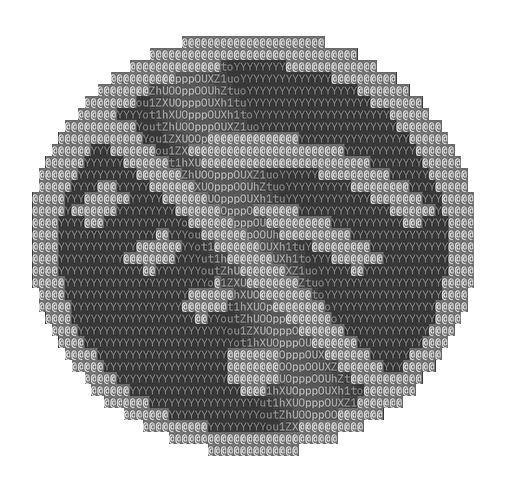

  

<h1 align="center">OfflineCoin</h1>

  <strong>The niches are full, so let's go after the market that doesn't exist.</strong>

  <a href="README.ko.md">한국어</a>

Bitcoin took digital money. Other coins took speed, privacy and everything else Bitcoin left behind. OfflineCoin went where nobody wanted to go: a coin that works with no internet at all.

It is a real coin with a real chain, mined and checked by the people running it. It has no company behind it, no exchange and no price. It's made for fun, so treat it as a toy.

## Download

| Your computer | Download |
|---|---|
| Windows | [OLC Core for Windows](https://github.com/needmoretruth/OfflineCoin/releases/latest/download/OLC-Core-windows-x86_64-setup.exe) |
| Mac with an Apple chip | [OLC Core for Mac](https://github.com/needmoretruth/OfflineCoin/releases/latest/download/OLC-Core-macos-apple-silicon.dmg) |
| Mac with an Intel chip | [OLC Core for Intel Mac](https://github.com/needmoretruth/OfflineCoin/releases/latest/download/OLC-Core-macos-intel.dmg) |
| Ubuntu, Debian or Mint | [OLC Core for Linux](https://github.com/needmoretruth/OfflineCoin/releases/latest/download/OLC-Core-linux-x86_64.deb) |
| Raspberry Pi | [OLC Core for Raspberry Pi](https://github.com/needmoretruth/OfflineCoin/releases/latest/download/OLC-Core-linux-arm64.deb) |

Other systems are on the [releases page](https://github.com/needmoretruth/OfflineCoin/releases/latest).

Your computer will warn you the first time, because this app isn't signed.

- **Windows** says "Windows protected your PC". Choose **More info**, then **Run anyway**.
- **Mac** says it can't check the app. Open **System Settings**, then **Privacy & Security**, and choose **Open Anyway**.

## Get started

1. Open **OLC Core** and answer the short questions.
2. Press **Start mining**. Your computer starts looking for coins.
3. When it finds a block, coins appear on the Home page.

To get coins from someone, press **Receive** and give them your address. To pay someone, press **Send**.

## With other people

Pick **Two computers** when OLC Core asks what you'll mine with. If your computer asks whether the app may use the network, say yes.

Anyone on the same Wi-Fi opens OLC Core, goes to **Coins** and presses **Join**. No internet needed.

You can make your own coin too. On the **Coins** page, press **New coin**, then give it a name and your own rules.

## Small boards

OfflineCoin also runs on a tiny board with a small screen, with no computer once it's set up. It mines, keeps the whole chain and talks to other boards by radio. Plug one into your computer and press **Set up** in OLC Core. The [technical guide](docs/technical.md) says which boards work.

## Keep your coins safe

- Go to **Settings** and press **Back up**. If you lose your wallet with no backup, your coins are gone.
- Anyone who gets your wallet file can spend your coins. It isn't encrypted.
- Anyone with more mining power can rewrite the chain. On a coin like this, that's part of the fun.

## The coin

| | |
|---|---|
| Name | OfflineCoin (OLC) |
| Chain | OLC Chain (OLCC) |
| Contracts | OLC Language (OLCL) |
| Mining | Proof of work, SHA-256d |
| Block time | 30 seconds |
| Block reward | 50 OLC, halving every 210,000 blocks |
| Total supply | About 21 million OLC |
| Premine | None |

## More

- [Technical guide](docs/technical.md): the command line, boards, connections and how to build it.
- [Measurements](docs/measurements.md): what it does on real hardware.
- [Changelog](CHANGELOG.md): what changed in each version.

## License

Apache-2.0. Pull requests need one line agreeing to the [CLA](CLA.md).
